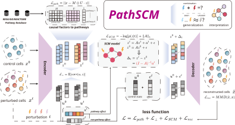

# PathSCM

PathSCM predicts single-cell responses to genetic perturbations using a pathway-level structural causal model. It encodes control cells into pathway states and background variation, propagates perturbations through pathway interactions, and decodes the resulting expression profiles. Follow the steps below to prepare **K562, RPE1, and HepG2**, train PathSCM and four baselines (**GEARS, scGen, discrepancy-VAE, SENA**), and compute prediction metrics on held-out cell batches for seen perturbations.



## 1. Environment

Run commands from the repository root on Linux. Use Python 3.10 and a CUDA GPU (required for scGen training). Install a hardware-compatible PyTorch build before the requirements.


```bash
python3.10 -m venv .venv
source .venv/bin/activate
python -m pip install --upgrade pip
python -m pip install -r requirements-dev.txt
python -m baselines.setup --method all
python tests/run_checks.py
```

Expected: the main environment and pinned baseline sources are ready, and checks pass.

<details>
<summary>Additional environments for GEARS and scGen</summary>

Keep the main environment active; the launcher selects these interpreters automatically via the exported variables.

```bash
python3.10 -m venv .venv-gears
.venv-gears/bin/python -m pip install -r baselines/requirements/gears.txt
export PATHSCM_GEARS_PYTHON="$PWD/.venv-gears/bin/python"

conda create -n pathscm-scgen python=3.9 pip=24.0 -y
conda run -n pathscm-scgen python -m pip install 'setuptools<81'
conda run -n pathscm-scgen python -m pip install -r baselines/requirements/scgen.txt
export PATHSCM_SCGEN_PYTHON="$(conda run -n pathscm-scgen python -c 'import sys; print(sys.executable)')"
```

</details>

## 2. Data processing

Sources: [K562 (scPerturb)](https://zenodo.org/records/7416068), [RPE1 (GEARS)](https://dataverse.harvard.edu/api/access/datafile/7458694), and [HepG2 (Nadig)](https://huggingface.co/datasets/arcinstitute/Replogle-Nadig-Preprint/blob/main/GSE264667_hepg2_raw_singlecell_01.h5ad).

```bash
for dataset in k562 rpe1 hepg2; do
  python -m data.download --dataset "$dataset"
done
unzip -n datasets/raw/replogle_rpe1_essential.zip -d datasets/raw/rpe1_archive

python -m data.prepare --dataset k562 --input datasets/raw/replogle_2022_k562_essential.h5ad
python -m data.prepare --dataset rpe1 --input datasets/raw/rpe1_archive/replogle_rpe1_essential/perturb_processed.h5ad
python -m data.prepare --dataset hepg2 --input datasets/raw/hepg2_raw_singlecell_01.h5ad
```

Adjust the RPE1 input path if its archive layout differs. Preparation applies the original cell splits, 2,000-gene selection, scaling, and supplied Reactome snapshot, then verifies consistency with the original data.

Expected files for each dataset:

```text
datasets/processed/DATASET_generative_v3.h5ad       # reference / GEARS
datasets/processed/DATASET_generative_v3_k64.h5ad   # PathSCM / other baselines
```

## 3. Train

`run.py` launches the trainers in `pathscm/` and `baselines/` using the saved settings in `configs/`.

```bash
for dataset in k562 rpe1 hepg2; do
  python run.py train --dataset "$dataset" --method all --seeds 0 1 2 --device cuda
done
```

Use `--method PathSCM` to train only our model, or add `--dry-run` to preview commands. Expected: trained models and exports under `checkpoints/` for all five methods and three seeds per dataset. Existing outputs are not overwritten; GEARS downloads its gene priors on first use.

## 4. Test and expected results

Evaluate from the main environment. The code in `evaluation/` computes Pearson Δ (higher is better), all-gene effect MSE, and distribution MMD² (lower is better).

```bash
for dataset in k562 rpe1 hepg2; do
  python run.py evaluate --dataset "$dataset" --method all --seeds 0 1 2 --device cuda
done
python run.py summarize --protocol seen
```

Expected: `results/seen/` contains per-perturbation CSVs, `per_seed.csv`, and `summary.csv`. The summary reports each metric's mean and sample standard deviation across seeds 0, 1, and 2.

Existing PathSCM reference means:

| Dataset | Pearson Δ ↑ | MSE ↓ | MMD² ↓ |
|---|---:|---:|---:|
| K562 | 0.2936 | 0.0526 | 0.2515 |
| RPE1 | 0.5086 | 0.0809 | 0.3406 |
| HepG2 | 0.3915 | 0.0860 | 0.3389 |

All baseline references are in `configs/*_reference_metrics.json`. These are comparison values, not guaranteed outputs of fresh training. The reorganized code passed prediction and metric consistency checks recorded in `configs/validation.json`; full retraining was not repeated. Datasets and trained weights are not included.
